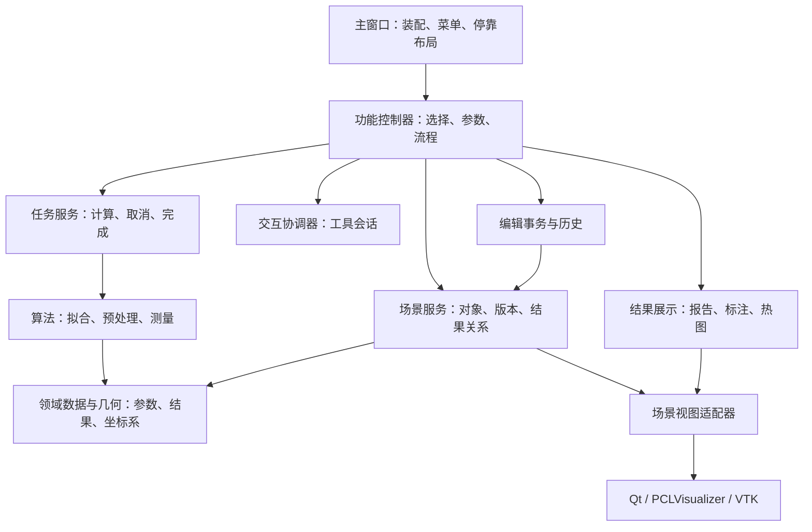

# CloudForge Analyzer 架构升级改革：详细规划方案

初版日期：2026-10-22。复核日期：2026-10-23。状态：**增量开发已完成；裁切纵向试点已落地并通过本机验证，全项目架构迁移尚未完成。**

当前调研基准：`HEAD db65280c3d606299f3a2bd66e017e19b738f5c4f`（统一热力图色标并支持不定数量凹坑标注）。初版所见的高度工具、测量展示、主窗口、平面度和验证程序修改已纳入该提交；本次工作区仅见 `Icons/icon_WeldGap.png` 删除，未处理。重构基线应登记该提交及这项本地差异；增量开发完成不等于本轮重新完成全部算法、Windows 或真实精度验收。

## 1. 建议决策

采用**保留现有技术栈和测量算法的模块化单体架构**，通过兼容入口逐项迁移。现在以已完成的增量版本登记行为基线，随后统一状态所有权、任务与交互生命周期、操作事务，最后拆分主窗口及清除计算层的界面依赖。

改革的成功标准是：一次编辑能完整恢复；一次计算只向仍然有效的对象提交结果；一个工具退出后不遗留交互状态；新增功能无需修改多个共享状态容器。主窗口行数降低只是这些改进的结果。

建议按以下顺序实施：

1. **P0 版本登记与基线准备**：登记已完成版本、复用现有验证证据、补齐必要基线与脚本资源限制。
2. **P1 场景模型与唯一写入口**：身份、版本、点云、显示属性、结果关联；同时建立最小事务边界。
3. **P2 任务服务**：统一任务身份、取消、失败、完成和过期结果丢弃。
4. **P3 交互会话**：复用已有工具，通过统一协调器管理互斥和清理。
5. **P4 完整撤销与展示恢复**：在前述模型上实现原子编辑和可重建的结果展示。
6. **P5 功能控制器与计算接口**：逐功能迁移参数、计算、报告、绘图，再收缩主窗口。
7. **P6 双平台验收与交付**：按获准范围做综合回归，交付架构说明及开发模板。

首个贯穿试点建议选择**多边形裁切**：已有纯计算入口、预览票号和验证程序，又能覆盖变换、双输出、撤销与取消。随后选择体素滤波验证普通后台任务，再迁移测量流程。凹塘与焊前装配放在公共边界稳定以后。

### 1.1 增量完成后的计划修订

| 项目 | 本次修订 | 原因 |
|---|---|---|
| 启动前提 | 删除“等待增量完成”，P0 改为版本登记与基线准备 | 用户已明确确认增量开发完成，主要修改已提交 |
| 展示组件 | `MeasurementPresentation`、统一色标和标注容量处理作为直接复用资产 | 当前组件已有实际功能和随提交保存的验证，不再重复建设 |
| 焊前显示 | 冻结当前已实现并有增量验证记录的显示行为；旧手册的“已删除可视化”列为历史文档过时 | 本次找到专门实施记录和相关提交；不再把恢复旧显示方案作为启动前置事项 |
| 试点颗粒度 | P1–P4 先贯穿裁切，只有第二个真实使用者出现后才扩大公共接口 | 限制过早抽象；避免同时重做所有功能 |
| 数据恢复范围 | 先完整支持编辑对象及其属性；测量结果/展示恢复按迁移批次扩展 | 旧的未迁移结果缺少足够元数据，不能靠一次通用快照声称完整恢复 |
| 验收 | 加入多结果容量、单倍/双倍缩放、色标与实际着色一致、已完成结果和临时会话分离 | 这些已成为完成版本的产品行为，重构必须保护 |
| 工程量 | P0 由 3–4 人日调为 1–2 人日，其余暂不下调 | 增量已结束，但状态、事务、任务等结构问题仍存在 |

**第一项可见收益必须在试点完成时出现**：裁切前后的坐标与属性保留，双输出一次撤销恢复，取消和过期预览不污染场景。若此时还只能展示新目录和类图，应缩小设计、先打通该流程。

### 1.2 希望把项目从什么样子改成什么样子

| 维度 | 目前 | 目标 | 对扩展开发的影响 |
|---|---|---|---|
| 功能接入 | 主窗口选择输入、读参数、启动计算、写 maps、画图并拼报告 | 功能控制器连接明确的输入、算法、结果和公共服务；主窗口只装配入口 | 新功能的修改主要落在自己的模块，共享文件改动更少 |
| 场景状态 | 点云、颜色、拟合系数、actor 和标注分散维护 | 一个对象记录持有业务状态，actor 是可重建的显示投影 | 新增数据属性只需定义一次，删除、恢复和失效有一致规则 |
| 后台计算 | 公共运行器加每个入口各自处理取消与完成 | 统一任务身份、输入版本、失败和提交条件 | 新算法接入公共取消/进度协议，无需复制窗口生命周期处理 |
| 交互 | 每个工具维护自己的状态，主窗口协调互斥和清理 | 工具保留专业交互步骤，公共协调器管理输入独占及父子会话 | 新的选线、框选、ROI 等工具可以复用生命周期规则 |
| 撤销 | 主要恢复点云和颜色；其他状态依赖入口补救 | 编辑事务一次提交，恢复数据、属性及已迁移的关联结果 | 新编辑操作声明输入与输出后复用历史，无需手动配对多次保存 |
| 参数与结果 | 部分字符串下标、匿名系数和重复默认值 | 具名类型、单一默认值、结果状态和展示描述分离 | 新字段可被编译器检查，参数窗口和批量调用可以共用输入结构 |
| 展示 | 已有共享组件，同时还有主窗口和旧 actor 管理路径 | 复用完成版本的组件，以结果 ID 登记完整展示及其清理 | 新测量可复用现有色标、引线、卡片、容量处理，减少重复绘图代码 |
| 验证 | 已有功能验证，但部分需访问主窗口私有成员和链接大量对象 | 从公开边界验证模型、任务、算法及展示，再走真实桌面流程 | 算法可更独立地验证；其他功能的回归范围更容易判断 |

例如今后增加“壁厚测量”：开发者仍需实现和验证壁厚算法、明确输入及测量定义；工程接入主要是参数结构、控制器、结果展示适配和菜单装配。线程退出、对象删除、过期结果、撤销与图形清理应复用既有服务，不能再次散落到主窗口。

预期收益是改动范围更可控、功能组合更可靠、多人协作更少冲突，以及同一算法未来更容易接入批量验证或其他界面。它不自动提高测量精度，也不保证算法运行更快；Qt/PCL/VTK 和单可执行程序仍然保留。初期会增加接口、适配与验证工作，收益主要在后续持续扩展中体现。

### 1.3 裁切试点落地状态

分支为 `architecture-clip-pilot`。已提取 `ClipController`、独立任务上下文与执行器、纯场景快照及事务、旧场景兼容外观；裁切支持属性和身份恢复、双输出一次撤销、过期预览拒绝及关闭取消。本机契约检查 28 项通过，普通和双倍缩放桌面流程各 89 项通过。详见《裁切架构试点-实施与验证》。

这是 P1–P4 在一个功能上的纵向落地，不代表四个阶段已在全项目完成。旧 maps 仍为兼容存储，其他算法、拟合结果及测量结果历史未全面迁移；历史保留量已有计量，尚未按字节预算自动淘汰。Windows 与跨功能回归未执行。

根据用户最新要求，后续控制验证成本：每批以一次构建和直接相关验证为主，出现新故障或明确风险才扩展，不重复已通过且未受新修改影响的检查；跨功能验证仍按既有授权边界执行。

## 2. 范围与约束

### 2.1 本轮规划涵盖

- 数据及结果的身份、所有权、关联失效规则。
- GUI、计算、交互、渲染、撤销和报告之间的边界。
- 旧代码兼容迁移、阶段验收、资源预算和回退办法。
- 当前文档与代码差异，以及需由项目负责人或甲方确认的事项。

规划编制与方案复核阶段仅做文档阅读和静态核对；随后裁切试点的实施与验证单独记录于 §1.3 及试点报告。其他功能的历史通过数不代表已重新验证。

### 2.2 实施期间持续有效的硬约束

| 约束 | 对方案的影响 |
|---|---|
| Qt 6.7.3 / PCL 1.14.0 / VTK 9.3.0 精确锁定 | 不以升级依赖作为重构前提，不换 GUI 或渲染栈 |
| 不改 `CMakeLists.txt`、Windows 预设和旧工程文件 | 本期只做源码层模块化；继续由现有递归 GLOB 收集 `Inc/`、`Src/` 文件 |
| 验证程序放 `analysis/` | 不新增正式 CMake 测试目标；保留独立脚本验证方式 |
| VTK/Qt/查看器/点云表/撤销只在 GUI 线程 | 新服务必须显式标出线程归属；计算核心不持有 GUI 对象 |
| 不清理未跟踪文件，不覆盖他人修改 | 开始实施时保护当前增量改动，迁移补丁保持小而可回退 |
| 单次构建、最多 2 并发、8 GiB 保护 | 全部 Linux 构建和验证入口遵循 `analysis/run_guarded.sh`；禁止并行启动多个构建 |
| 跨功能回归先获用户同意 | 自动化只选择和解释受影响范围，不默认运行全套回归 |
| 软件只显示结果级文本 | 内部诊断、参数、来源追踪与客户可见报告分离 |

暂不列入本期：插件框架、微服务、云端计算、数据库、通用流程编排平台、扫描硬件接入、工程文件持久化、新算法、依赖升级。后续若有实际产品需求，再利用稳定接口扩展。

## 3. 当前项目判断与证据

### 3.1 业务理解

项目已具备加载点云、预处理、拟合、测量、裁切、结果展示和保存的完整桌面工作链。典型业务是大型圆柱构件的局部扫描区域，涉及百万级点云、形面偏差、局部缺陷和装配尺寸。

必须保护的领域含义：

- 小弧段的自由半径拟合存在不稳定性；设计半径和轴线来源属于测量前提，不能在重构中无意替换。
- 凹塘的局部下凹量与到理想柱面的全局距离是不同量，结果模型应分别命名。
- 焊前阶差为径向差 `e_P − e_Q`，近件在外为正；环缝间隙为轴向开口，两量来自同一次配对。
- 设计圆柱可展开，不代表偏离柱面的真实表面投影后仍严格保长；不得用公共几何组件偷换测量定义。
- 不可测、部分可测、未提供合格限值、合格、不合格应分开表达；不得用零值代表失败。

### 3.2 实际抽查发现

以下是静态证据及其影响，不将潜在风险写成已复现故障。

| 主题 | 当前证据 | 架构含义与处理优先级 |
|---|---|---|
| 主窗口集中编排 | `Src/CloudForgeAnalyzer.cpp` 本次读取为 4,148 行；头文件 291 行。包含导入、拟合、测量、绘图、任务、撤销 | P1 起收敛状态，P5 提取流程；不先机械拆文件 |
| 状态存在多套表示 | 主窗口持有 `CloudMap`、`ColorMap`、`RGBCloudMap`、`LineMap`、`ActorMap`、圆柱/平面结果池及多组 actor 标识；PCL 还有 actor 表 | P1 明确唯一数据所有者，渲染对象作为派生状态 |
| 新结构已具雏形 | `ViewportPointPicker`、`PolygonClipTool`、`HeightMeasureTool`、`WeldParallelismTool`、`ArcMeasurementTool` 已分离；`MeasurementPresentation` 已按组管理展示 | 复用已有实现，统一其协议；无需再造一套工具或展示框架 |
| 最新展示增量已完成 | `db65280` 统一色标；标注按实际数量布局，拥挤时提供选择栏；提交内 `analysis/measurement_visuals/validation.txt` 记录普通与双倍缩放各 124 项通过 | 将完成行为纳入展示契约；这些为已有记录，本轮未重新执行 |
| 撤销范围不足 | `UndoRedoManager::Entry` 仅保存点云与颜色，共享指针快照，历史上限 20 | P4 补齐逻辑属性及关联结果，保持共享数据优势 |
| 裁切暴露恢复范围缺口 | `ApplyPolygonClip()` 复制 actor 矩阵、点大小、透明度；撤销重建只按点云和颜色重建，并重设相机 | 变换与显示属性必须进入模型；相机恢复策略单独确认 |
| 清理与数据编辑耦合 | `AddPointCloud()`、删除、清空、重建中重复停止工具、清空展示 | P1/P3 统一变更通知与工具失效；先保持旧行为，再单独评审改善 |
| 异步公共边界不完整 | `RunAsyncVoid()` 完成后仍调用 `onFinished`；取消判断依赖各完成回调；公共包装未统一承载成功/失败结果 | P2 统一状态和提交条件；不推断所有取消路径现在都有故障 |
| 过期保护分散 | 裁切有 `ticket()`，选点有 `m_pointSelectionRevision`，弧长有 `m_arcRequestRevision` | 提炼为任务/会话身份与输入版本校验，保留这些有效防线 |
| 旧计算类仍有界面依赖 | `Fit_Cylinder.h` 引入 `Dialog/Dialog.h` 并保留 dialog 成员；多个滤波/分割类保留对话框构造路径 | P5 逐类迁出旧交互路径，兼容放在 GUI 适配层 |
| 算法和绘图仍混合 | `MeasureArc`、`GeodesicArcMeasurer` 提供 VTK actor 构造；前者依赖关闭自动构造 actor 的开关 | P5 让计算返回几何数据，GUI 工厂创建 actor，消除调用约定陷阱 |
| 汇总头扩大依赖 | 主窗口包含三个 config 汇总头和多个业务汇总头；`config/pcl114.h` 也引入 PCL 可视化与 VTK IO | P5 按实际类型直接包含；核心算法不得间接带入渲染依赖 |
| 构造函数存在隐式流程 | `ChoseCyDialog` 构造内执行 `exec()`；调用方专门注释避免重复执行 | GUI 选择流程改为显式启动；迁移前清点全部调用点 |
| 验证能力已积累 | 已有测距、选点、裁切、高度、平面拟合、焊缝平行度、展示、焊前装配、凹塘的验证入口 | 延用并增强契约测试，不能再笼统称“没有验证体系” |
| 验证工具仍依赖主程序内部 | 多个脚本解析 `build.ninja` 链接大量目标文件，部分使用 `-fno-access-control` | P5 后新增边界测试只用公开接口；既有测试逐步替换 |
| 资源保护存在缺口 | 凹塘和焊前装配脚本调用裸 `ninja`，没有 `-j 2`；其他脚本的保护方式也不统一 | P0 修正入口后才能执行；只在外层限内存不能代替限制编译并发 |

### 3.3 文档差异清单：正式冻结前逐项裁定

| 文档说法 | 本次代码证据 | 处理 |
|---|---|---|
| 总规划开头称焊前功能未实现，后文又称已实现 | 主窗口已有完整入口、算法和验证程序 | 更新状态索引；历史文本注明日期 |
| 焊前功能在流程内拟合远件、使用 13 项参数对话框 | 当前入口选择已保存圆柱，调用 `setFixedReferenceAxis()`；用户选近/远件，参数自动设置、固定轴向；原参数对话框路径不存在 | 冻结当前候选行为，核实这是哪个已确认的产品变更；不按旧代码地图补回旧参数框 |
| 执行手册称焊前三维可视化已删除 | 当前有 `VisualizeWeldPreparation()` 及 `WeldPreparationOverlay`；专门的醒目性增量文档记录了实施、正常/双倍缩放各 28 项检查及报告一致性 | 依据最新增量完成状态保留现状，更新旧手册；不在重构中恢复旧描述。现有显示验证不等于全部选择流程和真实精度验收 |
| 焊前头部注释/测试案例描述仍有周向阶差旧定义 | 同一算法实现和专项断言已包含径向差定义 | 修改注释与案例描述前核对断言；不得通过改断言迁就旧文字 |
| 总规划含 16 并发构建命令 | 最新 AGENTS 与执行手册限制最多 2 并发、8 GiB | 按最新明确约束执行；P0 更新唯一有效命令入口 |
| 旧文档的主窗口行数、功能数量、通过数 | 近期代码已有多轮增量；历史通过数出现 44、53、57 等不同版本 | P0 为每份证据记录版本、命令、样本和日期；不得混用 |
| STL 流程文案按“米”描述，测量多以 mm 输出 | 主窗口导入代码可见米单位和相应采样常量；尚未完成全链路单位审计 | **待确认：实际输入单位及转换策略。** 仅凭文案不认定存在 1000 倍数值错误 |

不继承备忘中的“6/10”作为全仓库审计分数。本方案依据实际边界问题排优先级；未审阅的实现不作缺陷断言。

## 4. 目标架构

### 4.1 模块与依赖方向



图中场景服务到视图适配器通过窄通知接口连接，场景记录不保存 VTK 类型。主窗口创建并注入实例，不引入全局服务定位器或通用事件总线。

| 模块 | 责任 | 明确禁止 |
|---|---|---|
| 领域数据与几何 | 标识、版本、参数、结果、坐标系、单位与几何描述 | Qt、VTK、查看器、对话框、主窗口依赖 |
| 算法 | 输入数据与参数 → 结果；进度和取消检查 | 修改场景、推撤销记录、格式化界面、创建 actor |
| 场景服务 | 唯一对象记录、关联结果、变更集 | 作为第二个主窗口，混入功能流程 |
| 任务服务 | 任务上下文、异常封装、取消、主线程交付 | 在 worker 中访问场景容器或控件 |
| 交互协调器 | 活动工具、临时选点、光标/事件监听恢复 | 保存业务结果或直接修改点云 |
| 展示服务 | 将结果描述转成文字、热图、轮廓和标注 | 再算测量数值或修改结果结论 |
| 功能控制器 | 收集输入，调用服务，提交操作 | 任意读写全局容器、持有所有功能依赖 |
| 主窗口 | 生命周期装配、菜单绑定、布局 | 算法分支、结果格式化、actor 创建和历史细节 |

当前 CMake 仍生成一个应用目标。边界先通过窄头文件、定向依赖、公开接口测试和扫描规则约束。独立静态库、安装包拆分不属于本期承诺。

### 4.2 推荐目录与现有代码对应

以下是拟新增位置，实施时按需求逐个建立，不提前创建空框架。

| 拟定位置（`Inc/`、`Src/` 对应） | 内容 | 迁移来源 |
|---|---|---|
| `Domain/` | `SceneTypes`、`ResultTypes`、`TaskContext`、几何数据描述 | 现有结果结构与必要的新身份类型 |
| `Scene/` | `SceneRepository`、`SceneService`、`SceneTransaction`、`SceneHistory` | 主窗口 maps、增删逻辑、`UndoRedoManager` |
| `Application/` | `TaskRunner`、`InteractionCoordinator` | `RunAsyncVoid`、工具互斥与状态检查 |
| `Controllers/` | `FileController`、`ClipController`、按功能分组的拟合/测量控制器 | 对应槽函数及续接函数 |
| `Presentation/` | `SceneViewAdapter`、报告格式化、几何 actor 工厂 | 主窗口绘图逻辑；逐步吸收现有 `MeasurementPresentation` |
| `Fitting/`、`PreProcessing/`、`Measure/` | 保留现有算法目录 | 去除界面依赖后继续使用 |
| `Basic/` | 先保留现有工具路径；几何与 GUI 工具分批归位 | 避免大规模移动路径与逻辑修改同时发生 |
| `analysis/architecture/` | 边界检查、场景/事务/任务契约验证、测试范围清单 | 新增验证，不进入生产构建 |

`CylinderSurfaceFrame` 优先复用。凹塘若有自己的展开约定，先比较轴向、角度分支、符号、精度和遍历顺序，再决定共享；公共底座先统一语义及契约，不立即替换数值实现。

## 5. 核心设计

### 5.1 场景记录：身份与显示名称分离

建议的概念模型：

| 记录 | 最少字段 |
|---|---|
| `CloudRecord` | 稳定 `CloudId`、名称、只读点云数据、数据版本、坐标版本、模型到场景变换、单位、颜色/透明度/点大小/可见性、导入来源 |
| `ReferenceRecord` | `ReferenceId`、平面/圆柱等类型、具名系数、来源对象及版本、半径约束状态、有效性 |
| `MeasurementRecord` | `ResultId`、测量类型、源对象及版本、基准及版本、参数快照、算法版本、测量结果、可测状态、合格判断状态 |
| `PresentationSpec` | 结果标识、热图/曲线/标注等纯数据、显示选项；大型数组共享不可变存储 |
| `RenderRegistry` | `CloudId/ResultId → actor 集合`；只存在于 GUI 展示层 |

稳定 ID 不依赖名称、容器地址或 actor 指针。更名不改变身份；复制产生新 ID。XYZ 点云、原生 RGB 数据与结果热图须区分角色，不能把所有 RGB actor 都当作新的可测对象。

场景服务提供窄接口：查对象、取只读快照、添加、替换、删除、设置显示属性、登记结果、应用变更集。禁止把可写 map 引用返回给控制器。

**共享指针不等于不可变。** 只读快照生效的条件是不存在其他写别名：导入/产生新点云时转移数据所有权；旧算法必须写入输入时复制工作数据；转换完成后才接入只读记录。不得仅把 `Ptr` 转为 `ConstPtr` 就宣称历史已安全。

### 5.2 版本与结果失效

至少区分数据版本、坐标版本和显示版本。颜色、名称变化不使测量数值失效；点坐标或测量使用的变换变化需要检查依赖。预览若依赖相机投影，还需记录投影版本。

| 变更 | 默认规则 |
|---|---|
| 重命名、纯颜色/点大小变化 | 保留测量；更新展示 |
| 隐藏对象 | 停止对该对象选点；结果是否跟随隐藏由展示策略决定 |
| 替换、裁切或删除源点云 | 相关基准和测量退出“当前有效结果”；清除对应展示；历史仍可保留数据 |
| 更换圆柱/平面基准 | 引用旧版本的结果失效；不得静默绑定新基准 |
| 刚体变换 | 第一阶段保守失效；后续只有数学契约与测试完整时，才支持数值不变、位置同步变换 |
| 撤销/重做 | 恢复记录及其引用关系；会话世代仍递增，禁止旧任务因版本恢复而重新变得可提交 |

结果来源和参数保存在内部追溯数据中，不进入客户报告。缺失来源的旧基准标记 `LegacyUnknown`，不能猜测“自由拟合”或“固定设计半径”。哪些旧基准允许参与测量属于 **待确认的兼容策略**，不能在结构迁移中静默改变可选范围。

### 5.3 坐标、变换与单位契约

先完成现有功能审计，列出每项测量实际使用“点云原始坐标”还是“场景显示坐标”。随后形成统一契约：源点数据保留原始坐标；需要测量场景位置时显式应用 `modelToScene`，输入和基准必须位于同一坐标系；输出位置带坐标归属。

新契约推荐内部工程长度统一为 mm，角度内部使用明确标注的弧度/角度字段；导入边界负责转换。既有文件单位未知时不得自动猜测或乘 1000。单位纠正若改变旧结果，要作为独立行为修复，有样本对照并经确认，不能夹带在重构提交中。

保留计算所需的 double 精度与当前点类型，避免为了统一类型批量改变浮点精度。

### 5.4 编辑事务与撤销

采用**不可变点云共享 + 记录级前后状态差量**。先保持当前快照方式可运行，再让同一事务输出前后记录集；无需立即引入完整事件溯源系统。

事务流程：准备完整新记录 → 校验输入版本和名称/ID → 一次提交模型变更及历史 → 发布一个变更集 → GUI 批量刷新。多输出操作提交一个历史条目；空操作不记录；异常或取消不提交。

RAII 事务对象默认回滚，显式 `commit()` 才生效，替代需要手工配对的 `beginUndoBatch/endUndoBatch`。模型提交要具备强异常保证；显示层同步失败时保留一致的模型，并可重建视图、报告失败，不继续留下部分“成功”的 UI。

| 状态 | 建议撤销语义 |
|---|---|
| 点云添加、删除、替换、裁切 | 必须恢复数据和身份 |
| 颜色、变换、可见性、点大小、透明度 | 必须恢复该操作影响的属性 |
| 基准与测量结果 | 恢复其数据、有效性和关联；不自动重新计算 |
| 结果标注、热图、轮廓 | 由恢复后的结果与展示描述重建；不保存 VTK 对象 |
| 光标、悬停、半成品选点、预览 | 不进业务历史，撤销前结束会话 |
| 相机、停靠面板布局、选择集 | 建议与业务撤销分离；保留当前视角的行为变化需在 P0 确认 |
| 文件导出 | 不把外部文件操作伪装成可撤销场景编辑 |

历史继续保留数量上限，同时增加按唯一数据缓冲区估算的字节预算，避免 20 条历史都持有百万点云。预算需结合实际峰值测量确定，**不在未测量前写死具体容量**；淘汰历史不影响当前场景，redo 引用纳入同一预算。

### 5.5 后台任务与生命周期

保留单活动计算任务，避免引入多任务并行与 PCL/OpenMP 线程叠加。`TaskRunner` 可依赖 Qt，但其 worker 接收的 `TaskContext` 为纯 C++ 数据。

每个任务带：任务 ID、工具会话 ID、只读输入快照、数据/坐标/基准版本、取消标记、进度回调；完成包包含 `Success / Cancelled / Failed` 与类型化结果。领域内的“部分可测”属于结果状态，不与任务失败混为一谈。

GUI 提交检查：窗口未关闭、任务身份匹配、会话仍有效、输入及基准版本匹配、未取消、任务成功。条件不满足时释放结果，不修改场景、报告或历史。纯预览允许返回到对应会话，正式应用仍经事务校验。

具体要求：

- worker 捕获独立任务上下文和输入，逐步去掉对主窗口 `this` 的依赖。
- 统一捕获异常并返回失败包；错误原因进入内部诊断，界面只映射结果级短句。
- 取消是协作式：检查点多的算法及时终止；不能中断的第三方计算完成后丢弃结果。测量取消延迟后再给验收阈值，不承诺所有算法立即停止。
- 保留当前关闭时先取消、等待的安全语义；P2 可增加“正在结束计算”的关闭流程，禁止强杀线程或提前销毁其输入。
- 高频进度合并更新；诊断队列设边界，避免大量逐点日志占用内存或阻塞界面。
- 首轮保持计算期间禁止场景编辑的限制；版本校验作为额外防线，不借此立即开放并发编辑。

### 5.6 交互工具生命周期

统一状态：`Idle → Active → Previewing/Computing → Completed 或 Cancelling → Idle`。工具自身保留专业步骤，协调器只负责资源独占、切换、取消和释放，不承担算法。

复用各工具的 `start/stop/clear`，通过薄适配器统一为 `enter / cancel / leave / onSceneChanged`；`leave()` 可重复调用。会话拥有鼠标事件过滤器、VTK observer、计时器、光标、临时 actor 和源对象显示覆盖状态，退出时逐项恢复。

约束：

- 同时只有一个会消费视窗点击的活动会话。
- 圆弧工具调用选点属于同一父会话的子步骤，不能被协调器当成竞争工具取消父流程。
- 停靠面板可以保持可见；“可见面板”与“拥有鼠标输入”分开。
- 源对象删除、替换、隐藏、撤销、打开新场景、关闭窗口、工具切换均走统一退出路径。
- 显示覆盖恢复采用所有者令牌或当前模型重投影，避免后退出的工具覆盖其他工具的新属性。
- 初始化时不提前读取相机而改变默认视角；把渲染器、interactor、工具创建顺序列为契约。

### 5.7 算法、参数与结果契约

现有 `Params`、`Result` 优先保留；允许薄适配，不要求所有功能继承一个复杂泛型基类。

参数改造分三步：

1. 在 GUI 边界建立有类型的读取适配器，集中处理旧 `QStringList` 下标、范围和转换失败；旧数组顺序不变，新字段仍只能追加。
2. 每个算法参数结构成为默认值的唯一来源，对话框由该结构初始化，删除主窗口重复默认值。
3. 一个功能所有调用点迁移完成后，才移除其旧字符串数组 API 和隐式弹框构造。兼容包装放在 GUI 层，计算层不长期保留对话框。

统一检查空输入、非有限数、无效半径/方向、单位与坐标不一致、非法阈值。不要用自动兜底将非法用户输入变成另一个合法测量。

结果分为计算数值、可测状态、合格判断和几何描述。无甲方限值时状态为“未判定”，不能默认通过。圆柱系数从匿名数组逐步适配为轴上一点、单位轴向、设计半径与来源约束；旧数组仍可由兼容器生成。

### 5.8 展示与客户文本

沿用 `MeasurementPresentation` 的组所有权和上下文恢复能力。按 `ResultId` 管理热图、曲线、标注、图例与结果行，逐步将主窗口零散 actor 管理迁入同一登记入口。

- 结果报告格式化器只读领域结果；算法不返回唯一不可拆的 UI 报告字符串。
- 图形工厂只在 GUI 线程将几何描述转换为 VTK 对象。
- 报告与结果面板共享数值及格式规则，避免两处各算最大值或各自判断合格。
- 内部诊断输出到独立诊断渠道；当前 `PostLog → TeEDebug` 可见通道不能直接承载内部错误细节。
- 客户文本只输出测量结果、必要位置、通过与否或简短不可测原因；进度只保留操作动作词。
- 凹塘保留局部基准和全局基准的正确术语，逐坑一行，并保留到理想柱面最大距离与位置。
- 当前屏幕叠层沿用完成版本的逻辑像素排版、引线、锚点、主结果优先和拥挤选择栏。对仍使用世界单位三维标签的旧路径继续保留 `clamp(0.022 × 包围盒对角线, 6, 14) mm`、1.15/2.6 倍抬高规则；不能把该旧规则套回已完成的 Qt 结果卡片。
- `ColorScaleSpec` 应同时描述字段含义、单位、实际范围、归一化/饱和规则和颜色映射，热图及图例读取同一描述。统一面板外观不等于统一不同测量的颜色或数值范围；迁移时保留原 RGB 与饱和限值。
- 当前功能名分组可作为兼容键；支持多个独立结果的功能逐步改用稳定结果 ID。当前已有“重复测量替换上次结果”的功能继续保留该策略，不因新增结果模型擅自改为结果累积。
- 不设固定坑数上限或写死“四坑布局”。保留全部结果数据、编号、轮廓及可查询详情，视口空间不足时减少同时展开的卡片；区分保存结果总数、屏幕标签数量与内存预算。
- 工具面板关闭与已完成结果清除是不同动作；尤其保留圆弧关闭面板后仍保留已完成结果的行为。二维清理、RGB 清理、几何清理和全部清理分别定义其影响，不能简单合并成一个全清理接口。

## 6. 迁移方法与阶段计划

### 6.1 不允许出现两套可写事实源

场景迁移采用“先包入口、后换所有者”：

1. 先把现有增删查操作收敛到兼容外观，内部仍可使用旧容器；公开接口限制新代码越过边界。
2. 补齐元数据并把旧写入点全部导向同一入口。
3. 所有权切换到 `SceneRepository`；旧调用点读投影快照，写操作仍转发到场景服务。
4. 逐步删除旧容器成员和适配器。PCL actor 表始终只是渲染登记，不再成为业务查询依据。

过渡期若保留派生索引，必须只从主记录更新，具备一致性断言；不允许靠每个入口“双写两份 map”。拟合结果和测量结果逐域迁移，未迁移部分建立明确的临时桥接和失效通知。

P1 只为裁切建立最小所需接口；P2–P4 也先在该流程中验证。体素滤波作为第二个使用者时，再判断哪些接口确实公共。结果快照、完整展示恢复和追溯字段随功能迁移补齐：**未迁移功能不能被标记为已实现完整撤销**。P5 每批删除对应临时桥接，禁止长期积累两套调用体系。

### 6.2 工作包、交付物及退出条件

估算按一名熟悉 C++/Qt/PCL 的工程师持续投入、已有开发环境可用计算。数字是规划估算，P0 后重估。

| 阶段 | 主要文件/任务 | 交付与退出条件 | 人日 |
|---|---|---|---|
| P0 版本登记与基线准备 | 登记 `db65280` 与本地图标差异；复用验证记录；`analysis/*/build_test.sh`；基线清单 | 完成版本可复现；当前行为与历史文档有区分；必要的获准验证有记录；脚本明确限并发与内存 | 1–2 |
| P1 场景与试点 | `Scene/*`、`Domain/SceneTypes`；主窗口增删查；`ClipController` 最小入口 | 试点对象身份稳定、元数据完整、单一写入口；裁切前后数值/点序不变；最小事务可回滚 | 5–7 |
| P2 任务 | `Application/TaskRunner`、`Domain/TaskContext`；迁移裁切和体素滤波 | 成功/失败/取消/迟到四类结果有公共处理；取消与窗口关闭不提交半成品；worker 不访问主窗口 | 4–6 |
| P3 交互 | `InteractionCoordinator`；已有选点、裁切、高度、平行度、圆弧工具适配 | 互斥和父子会话工作；退出恢复鼠标/观察器/显示状态；快速切换无重复回调和残留 | 4–6 |
| P4 事务与历史 | `SceneTransaction`、`SceneHistory`；替换试点及已迁移使用点 | 裁切双输出一次撤销；变换/透明度/点大小及已迁移结果引用可恢复；失败不入栈；历史内存有计量与淘汰；其他功能列明待迁移范围 | 5–7 |
| P5 功能迁移 | `Controllers/*`、计算类、参数适配、报告/actor 工厂、主窗口头文件 | 各功能逐批过验收；计算层无 GUI/渲染依赖；旧容器无直接写入；主窗口只留装配与入口 | 8–12 |
| P6 平台交付 | 获准回归范围、Windows 安装包验证、GUI 记录、架构文档 | 两平台验证覆盖声明完整；已知限制单独列出；旧兼容层有清除结论；可回退节点齐全 | 4–6 |

复核后直接工程量约 **31–46 人日**，建议预留约 20% 风险余量，合计约 **38–56 人日，单人约 8–12 周**。不包含真实样本到位、甲方评审和外部 Windows 资源等待。P0–P4 约 **19–28 人日**加风险余量，先交付裁切及已迁移功能的状态、取消和撤销能力；P5–P6 约 **12–18 人日**，完成推广和交付。工期只因 P0 收窄而小幅下调，其余需在首个完整试点后重估，不能将增量开发结束等同于架构工作已经完成。

角色分工：工程实施负责人负责接口与迁移；Windows 维护者负责 MSVC 和桌面验证；项目负责人裁定行为与里程碑；甲方负责真实样本、缺陷性质及合格限值。同一人可兼任，但验收责任不能省略。

### 6.3 功能迁移顺序与每批要求

| 次序 | 功能批次 | 重点 |
|---|---|---|
| 1 | 多边形裁切 | 输入版本、投影快照、预览失效、双输出事务、完整属性恢复 |
| 2 | 体素/SOR/聚类 | 参数与只读输入、单/多输出操作、取消与结果丢弃 |
| 3 | 文件导入/追加/保存 | 场景替换事务、单位、导出输入快照；保留当前文件格式与交互 |
| 4 | 平面/直线/圆柱拟合 | 类型化基准、来源版本、旧构造清理；多阶段拟合保留阶段边界 |
| 5 | 测距/高度/平行度/弧长 | 已有工具适配，算法与 actor 分离，选点父子会话 |
| 6 | 圆柱度/焊缝高度/凹塘/焊前装配 | 精度与基准依赖最敏感，公共设施稳定后迁移；不变更已确认算法 |

每批至少拆成：边界适配 → 数值不变的实现迁移 → 验证与文档 → 删除该批旧入口。目录重命名、算法优化和产品行为变更单独提交，避免一个补丁同时改结构和结果。

## 7. 验证与验收

### 7.1 基线先固定“哪一个版本的行为”

基线清单建议记录：代码提交与工作区补丁、输入文件 SHA-256、参数/基准来源、平台/编译模式、PCL/OpenMP 配置、命令、退出码、原始结果、比较规则、GUI 截图与耗时/峰值内存。

凹塘历史基线仍是 `analysis/cylinder_patch/out_multipit/v9_final.txt`。当前增量版本若与其不同，先解释并确认差异再建立新的候选基线，不能直接覆盖旧证据。焊前历史的 57/57 是文档记录，本轮未复跑。

完成版本已有展示证据应直接登记：`analysis/measurement_visuals/validation.txt` 的 Task 4 记录普通与双倍缩放各 124 项、合计 248 项零失败，涵盖焊缝高度、凹坑、弧长、色标和标注容量。容量用例包含 1、2、5、11、29、53 个结果及 17 个聚集结果。四坑样本的局部最大深度为 1.54914587 mm、到理想柱面最大距离为 3.14428711 mm；这些是既有记录值，不是本轮新测量。测试结果、自动桌面事件和人工走查分别登记，不把自动化记录写成人眼复验。Windows Actions 触发记录也不替代实际成功结果与安装后的操作证据。

结构迁移的数值要求：同平台、同配置、相同输入下优先逐位一致，包括点数量/顺序、系数、极值位置和状态。差异必须逐条解释；不能用放宽容差掩盖变化。跨 GCC/MSVC、随机拟合或浮点归约差异，应先固定种子及执行配置，确需容差时按功能确认，不能全局套用一个 epsilon。

### 7.2 测试分层与范围

| 层 | 内容 | 通过标准 |
|---|---|---|
| 静态边界 | 核心算法禁 Qt/VTK/对话框依赖，禁止新增直接 map 写入，避免隐式执行构造 | 存量例外有清单；每迁移一批减少例外，不新增 |
| 模型/事务契约 | ID、版本、失败回滚、双输出、undo/redo、数据别名、结果失效 | 状态与关联一致；无半提交；晚到结果不能因撤销版本恢复而获准提交 |
| 任务/会话契约 | 取消、异常、关闭、切换、重复完成、输入替换、失效预览 | 不写入过期结果；所有资源释放一次；不触碰已销毁控件 |
| 数值对照 | 本功能已有 harness 与历史/候选基线 | 逐位一致或差异逐条经确认 |
| 展示契约 | actor 组、源可见性恢复、曲线/热图/图例、标注位置 | 与有效结果一致，无遗留引用；不改变初始相机 |
| 容量与缩放 | 多个/聚集结果、拥挤选择栏、单倍/双倍缩放、等值色标、多色标切换 | 结果不丢失、详情可查询、图例与实际 RGB 及范围一致；恢复少量结果时正常显示直接标注 |
| 真实桌面 | 实际加载、选择、运行、取消、切换、删除、撤销、重做、关闭 | 人眼看到正确结果与交互；截图及操作记录留档 |
| 双平台 | Ubuntu GCC 与 Windows MSVC，实际部署环境 | 构建、启动、关键操作和资源加载通过；缺失一端只能写“该端待验证” |

已有程序优先复用：

| 功能范围 | 现有验证入口 |
|---|---|
| 裁切 | `analysis/polygon_clip/test_polygon_clip.cpp` |
| 测距、选点 | `analysis/point_distance/test_distance.cpp`、`analysis/point_picking/test_point_picking.cpp` |
| 高度、平面拟合、焊缝平行度 | `analysis/height_measurement/test_height.cpp`、`analysis/plane_fitting/test_plane_fitting.cpp`、`analysis/weld_parallelism/test_weld_parallelism.cpp` |
| 结果面板、测量展示 | `analysis/viewport_results/test_viewport_results.cpp`、`analysis/measurement_visuals/test_measurement_visuals.cpp` |
| 凹塘、后台进度 | `analysis/cylinder_patch/test_cyl_pothole.cpp`、`analysis/cylinder_patch/test_async_progress.cpp` |
| 焊前装配 | `analysis/weld_preparation/test_weld_prep.cpp` |

新测试只补架构行为缺口，不为每个转发函数编写镜像测试。逐步去除对主窗口私有成员及 `-fno-access-control` 的依赖；验证脚本复用编译配置但选择最小依赖源文件，避免一直链接全部 GUI 对象。Linux Ninja 参数提取方式不能直接当作 Windows 测试方案；Windows 验证脚本须由维护者适配当前 MSVC 环境，不改受保护构建配置。

### 7.3 跨功能回归与资源保护

本轮没有运行任何回归。以后共享模块改动触及其他功能时，先提供“共享文件 → 风险功能 → 建议验证 → 预计耗时”的具体清单，获用户同意后再执行。获准范围可以按里程碑一次明确列出；增加范围需另行说明，不推定“架构重构”授权了全部功能回归。

当前主程序构建命令：

```bash
export VCPKG_ROOT=/home/jamesyasr/dsh-workspace/vcpkg
analysis/run_guarded.sh taskset -c 0-3 cmake --build build --parallel 2
```

验证脚本先修正内部并发，再用保护入口执行。现有 guard 使用锁，**不得外层和脚本内重复嵌套调用造成锁冲突**。推荐受保护的公开脚本加不单独运行的内部实现，统一规定仅外层取得保护锁。Windows 使用维护者确认的等效资源约束；Linux 脚本不能直接照搬。

性能基线按已获准样本记录端到端耗时、峰值 RSS、取消延迟、重复操作后的 actor 数与内存保留。建议以同机同配置多次运行的中位数比较；耗时超过候选基线约 10% 或出现整云冗余复制时进入调查，这只是工程调查阈值，**待 P0 实测后确认，不能作为测量精度标准**。

### 7.4 总体验收条件

1. 场景对象和结果只有一个业务事实源，控制器不能直接写容器。
2. 任意已迁移编辑成功仅生成一条正确历史，失败/取消不生成历史。
3. 撤销/重做恢复数据、显示属性、基准及结果关联；不需要重新计算测量。
4. 任务成功、失败、取消、过期、关闭均经过公共处理；worker 不访问 GUI 状态。
5. 交互工具退出后无残留 observer、eventFilter、timer、临时 actor 或错误可见性。
6. 计算核心无 Qt/VTK/查看器依赖；所有相关接口能够独立验证。
7. 已迁移功能结果保持基线一致；产品行为变更另有决策和证据。
8. 客户可见输出符合现行精简规范；内部追溯数据可用且不泄漏到报告。
9. Windows 与 Ubuntu 的验证状态均有明确记录；实际未验证部分不得写“通过”。
10. 用一个代表性新功能验证扩展路径：新增算法、参数、控制器、展示适配和测试即可接入，主窗口只需装配/绑定，无新增共享 map。

主窗口行数不设硬验收线。代码即使降到千行，若仍把所有服务细节串在一起，也不能认定改革完成。

## 8. 风险、暂停条件与回退

| 风险 | 动作 | 责任/时机 |
|---|---|---|
| 已完成版本未完整登记，后续修复混入重构 | P0 登记完成版本与本地差异；后续修复和重构分批记录 | 项目负责人、实施者 / 启动前 |
| 文档陈旧导致恢复旧需求 | 维护行为差异表；以用户决策和确认后的候选版本为准 | 项目负责人 / P0 |
| 新旧容器双写失配 | 单一写入口、临时只读投影、一致性断言 | 实施者 / P1 |
| 指针别名破坏历史 | 输入只读契约、旧算法隔离副本、历史不可变验证 | 实施者 / P1–P4 |
| GUI 生命周期与晚到回调 | 任务/会话身份及世代检查，关闭流程测试 | 实施者 / P2–P3 |
| 变换与单位迁移改变数值 | 逐功能审计坐标含义；任何修正单独立项 | 实施者、领域负责人 / P0、P5 |
| 历史、热图和缓存占满内存 | 按唯一缓冲区计量；可重建缓存先淘汰；数据规模测试 | 实施者 / P4 |
| 共享组件扩大回归范围 | 按影响清单征求同意，分功能证明后再继续 | 实施者、用户 / 每阶段 |
| Windows 资源不足或未参与 | 每个高风险阶段交付 Windows 可验证节点；缺失时阶段验收保留 | Windows 维护者 / P1 起 |
| 真实数据与甲方标准缺失 | 工程验收与测量精度验收分开；不得以重构通过替代真实精度证明 | 项目负责人、甲方 / 持续 |

**暂停当前迁移批次的条件**：出现不能解释的数值变化；场景与视图失配；撤销丢状态；取消/退出崩溃；资源超过保护上限；关键产品行为未明确。暂停该批迁移、保留证据、恢复到前一可运行节点，不能继续扩大改动范围。

回退通过小提交或补丁逆向恢复，不执行破坏性清理。阶段分支使用 `codex/architecture-<phase>` 等项目约定名称；保护当前增量改动后建立可恢复版本，是否提交由实施时工作流程确定。每阶段记录提交标识、涉及适配器、验证范围及回退注意事项。新旧完整实现不在生产环境同时计算，避免性能翻倍和结论不一致。

## 9. 待确认事项及其阻塞范围

| 决策 | 推荐意见 | 阻塞范围 |
|---|---|---|
| 增量收尾状态 | **已确认完成**；按 `db65280` 及本地差异登记基线，架构实施另行作为执行任务启动 | 不再以等待增量结束阻塞准备 |
| 焊前流程与标注 | 保留完成版本的选基准、近远件选择和现有标注；旧手册更新为历史差异 | 不阻塞结构迁移；新产品要求另行评审 |
| 撤销是否恢复相机和面板布局 | 建议业务撤销不改相机与布局；当前会重置视角，改变需明确 | P4 的视图行为 |
| 旧来源不明基准如何使用 | 记录来源未知；允许范围经确认后实施 | 基准有效性过滤，不阻塞记录结构 |
| 长度单位与既有样本约定 | 新契约采用 mm；旧数据未知单位不自动换算 | 单位转换和相关测量迁移 |
| Windows 验证责任与资源 | 每阶段安排维护者验证，高风险阶段提前参与 | 双平台完成声明 |
| 历史容量与性能调查阈值 | P0 测量后定预算与阈值 | P4/P6 的资源验收 |
| 跨功能回归范围 | 每阶段提交具体清单，按现行规则获准后运行 | 对应验证执行 |
| 凹塘真实 3 处候选性质、阈值 0.35 mm、椭圆尺寸定义 | 继续保留“待甲方确认”，不在重构中调整 | 算法结论和对外材料，不阻塞行为保持型重构 |
| 真实焊前/凹塘样本与合格限值 | 甲方提供有真值或可追溯对照的数据及标准 | 现场精度及合格判定承诺 |

## 10. 可直接拆分的首批实施任务

1. **完成版本登记**：以 `db65280` 及现有验证记录建立版本清单，登记本地图标删除、最新交互行为和历史文档差异。必要证据缺口按影响范围补齐，不重新开展增量开发。
2. **验证入口资源统一**：只修改相关 `analysis/` 脚本，消除无并发上限的 ninja 调用，定义不嵌套加锁方式。验收是所有入口受保护且串行执行；不自动启动其他功能回归。
3. **场景接口草案与最小模型**：定义 ID、版本、不可变数据、显示属性和依赖引用。用小合成点云测试身份、版本及失败回滚，不跑其他测量。
4. **裁切兼容外观**：现有菜单和工具保留，主窗口调用转至窄接口；用本功能验证证明裁切点集与点序一致。
5. **裁切完整事务试点**：一次提交两个输出，保留变换、颜色、透明度和点大小；实际桌面验证应用、撤销、重做和取消。
6. **试点评审**：确认额外数据复制、错误路径和撤销范围均可接受后，才推进公共任务服务与其他功能迁移。

每个任务交付记录包含：改动文件与行为、构建结果、本功能基线对照、获准的跨功能验证、实际 GUI 观察、未覆盖部分、文档同步及回退节点。实施者不得把“接口已抽出”写成“功能验收完成”。

## 11. 本次调研依据

- 项目规则：`AGENTS.md`、`docs/项目执行-上手与防错手册.md`。
- 背景与约束：`docs/项目总规划-交接简报.md`、`docs/增量开发上手指南-给Agent.md`、`docs/计算与UI线程分离改造说明.md`。
- 原始评估：`docs/架构评估与统一重构备忘.md`，其内容作为历史判断与规划输入，不视为本轮实施重构的指令。
- 当前代码抽查：主窗口、撤销管理器、测量展示、选点和裁切工具、圆柱/平面拟合接口、柱面坐标系、焊前装配、弧长/测地线相关接口，以及相关验证脚本。
- 2026-10-23 增量完成复核：比较 `af4a52b..db65280`，读取最新提交及 `analysis/measurement_visuals/validation.txt`；按需查阅《测量显示统一优化-执行与验证》《视窗结果标注-统一组件与清理》《焊前装配可视化-醒目性增量方案》。本轮只修改此规划文档。
- 范围限制：未通读整个 `docs/`，未逐行审计全部算法；未运行构建、回归或 GUI；未改变现有产品代码、依赖、构建配置和工作区既有改动。

增量开发完成后，本方案的技术主路线保持；当前应登记完成版本，以一个贯穿试点验证边界，再分批推广。已完成的显示、交互和数值行为均作为需要保护的资产。
